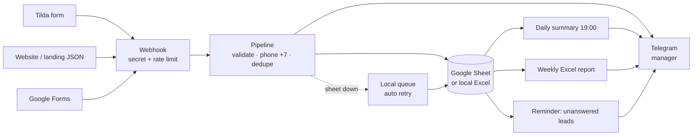
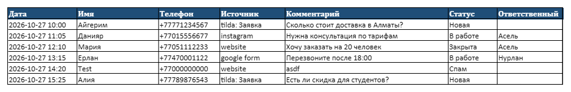
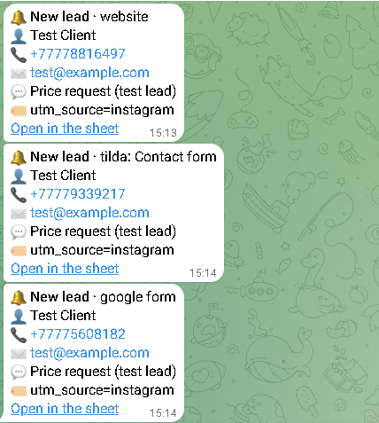

# Business Automation Kit

**Stop losing leads: every form submission lands in Google Sheets and pings your manager in Telegram within seconds.**

[](https://github.com/zhangir777/business-automation-kit/actions/workflows/ci.yml)

**Hire me:** [Fiverr](https://www.fiverr.com/akhmetov_zhangi) · [Telegram @ZhangirAkhmetov](https://t.me/ZhangirAkhmetov)



## 4 ready automations

| | Before | After |
|---|---|---|
| **Lead → Sheet → Telegram** | Leads sit in email or Tilda dashboard; someone checks once a day | Every lead is a row in one shared sheet and a Telegram message with a tap-to-call number in seconds |
| **Daily summary** | Owner asks managers “how many leads today?” | At 19:00 Almaty time: leads today, by source, how many still unprocessed |
| **Weekly Excel report** | Someone builds a report by hand on Monday | Monday 09:00: Excel with a chart by day, sources, statuses — in Telegram and/or email |
| **Unanswered lead reminder** | A lead waits for a call until the next day | If the status is still “Новая” after 2 hours, the manager gets a reminder |

Built to not lose data: phone numbers normalized to `+7…`, double submissions within 10 minutes are recorded once, and if Google Sheets is down the lead is kept in a local queue and added later automatically.

## Quick demo, no keys needed

```bash
git clone https://github.com/zhangir777/business-automation-kit && cd business-automation-kit
docker compose up -d --build          # or: uv sync && uv run uvicorn app.main:app
uv run python scripts/send_test_lead.py
```
Without Google/Telegram keys the app runs in **demo mode**: leads go to `data/leads.xlsx`, Telegram messages are printed to the log (`docker compose logs app`).



*Demo data generated by the app in demo mode; names and numbers are made up.*



*Real notifications from a live run (Telegram Web): one lead from a website JSON form, one from Tilda. Test data.*

## Working with me

**What I need from you:** where leads come from (Tilda, website, Google Form…), who should get notifications, the Google account that owns the sheet, which reports you want.
**Timeline:** 1–3 days, including testing on your real form. **Price:** from $80–150 per automation, support from $20/month.
**Python or n8n?**
- **n8n** (visual editor, `n8n/lead-to-sheet-telegram.json`) — if you want to change the logic yourself with the mouse.
- **Python** (this repo) — complex rules, deduplication, offline queue, reports; cheaper hosting (runs on the smallest VPS next to other services).

---

## Technical

FastAPI + uvicorn, pydantic, gspread (service account), httpx (Telegram Bot API), APScheduler, openpyxl, Docker.

| Endpoint | |
|---|---|
| `POST /webhook/tilda?secret=…` | Tilda form (form-urlencoded); answers `test=test` pings |
| `POST /webhook/json` + header `X-Webhook-Secret` | any JSON source |
| `POST /webhook/google-form` | Google Forms via Apps Script |
| `GET /health` | status and queue size |

Setup: copy `.env.example` → `.env`; Google: [docs/GOOGLE_SETUP.md](docs/GOOGLE_SETUP.md); Tilda / Google Forms: [docs/TILDA_SETUP.md](docs/TILDA_SETUP.md).
Security: webhook secret (constant-time compare), 30 requests/min per IP, 64 KB body limit, secrets only in `.env` and `secrets/` (git-ignored), the bot token is never logged.

Sheet columns: `Дата | Имя | Телефон | Источник | Комментарий | Статус | Ответственный | Email | UTM`, status is a dropdown (Новая / В работе / Закрыта / Спам), header frozen.

**Add a source:** write `parse(data: dict, now) -> Lead` in `app/sources/` (see `generic_json.py`), register it in `app/sources/__init__.py` → available at `/webhook/<name>`.
**Add a destination:** implement `append(lead) -> link` and `records()` (storage) or `async send(text)` (notifier) in `app/sinks/`, wire it in `build_pipeline` (`app/main.py`).

```bash
uv sync && uv run pytest -q    # 29 offline tests: sources, phones, dedupe, queue, reports, webhook security
```

**n8n:** `docker compose --profile n8n up -d` → http://localhost:5678 → Import `n8n/lead-to-sheet-telegram.json`, add Google and Telegram credentials, set sheet ID and chat ID. The workflow is exported by hand and **not yet tested in a live n8n instance** (no Docker on the dev machine).

## На русском

**Больше не теряете заявки.** Каждая заявка с сайта (Tilda, своя форма, Google Форма) за секунды попадает в Google Таблицу, а менеджер получает уведомление в Telegram с кликабельным номером.

- Каждый день в 19:00 — сводка: сколько заявок, откуда, сколько не обработано.
- По понедельникам — отчёт в Excel с графиком.
- Если заявку не взяли в работу за 2 часа — напоминание менеджеру.
- Телефоны приводятся к формату +7, дубли не записываются, при сбое Google заявка не теряется.

Срок 1–3 дня. Нужно от вас: откуда приходят заявки, кому слать уведомления, Google-аккаунт для таблицы.
